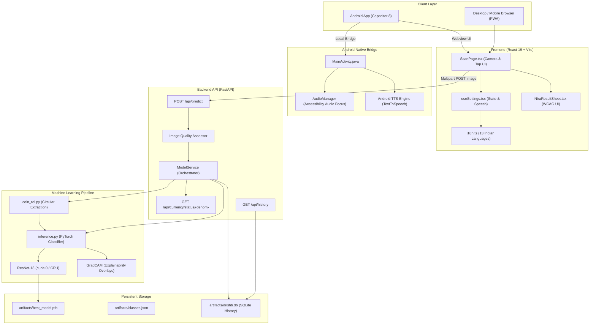

<div align="center">

  

  # NIRA — Accessible Currency Intelligence
  ### Real-Time Indian Banknote & Coin Recognition with Voice Guidance for Visually Impaired Users

  <p align="center">
    <b>A full-stack, GPU-accelerated assistive vision platform combining deep transfer learning (ResNet-18), FastAPI, React 19, and native Android accessibility audio routing.</b>
  </p>

  <!-- Technology Badges -->
  <p align="center">
    
    
    
    
    
    
    
  </p>

  <!-- Status & Metric Badges -->
  <p align="center">
    
    
    
    
    
    
  </p>

</div>

---

## Table of Contents

- [About NIRA](#about-nira)
  - [The Problem](#the-problem)
  - [The Solution](#the-solution)
- [Key Features](#key-features)
- [Application Preview & User Interface](#application-preview--user-interface)
- [How It Works](#how-it-works)
  - [Multi-Stage Inference Pipeline](#multi-stage-inference-pipeline)
  - [Circular Coin ROI Extraction](#circular-coin-roi-extraction)
  - [Logit-Margin Out-of-Distribution Rejection Gate](#logit-margin-out-of-distribution-rejection-gate)
- [System Architecture](#system-architecture)
- [Technology Stack](#technology-stack)
- [Supported Currency Classes (14 Canonical Denominations)](#supported-currency-classes-14-canonical-denominations)
- [Supported Languages & Accessibility Engineering](#supported-languages--accessibility-engineering)
- [Project Structure](#project-structure)
- [System Requirements](#system-requirements)
- [Installation & Setup](#installation--setup)
- [Running NIRA Locally](#running-nira-locally)
- [Building the Android APK](#building-the-android-apk)
- [Automated Testing & Verification](#automated-testing--verification)
- [Model Evaluation & Limitations](#model-evaluation--limitations)
- [Configuration & Security](#configuration--security)
- [Troubleshooting](#troubleshooting)
- [Roadmap](#roadmap)
- [Contributing](#contributing)
- [License & Acknowledgments](#license--acknowledgments)

---

## About NIRA

### The Problem
Over **40 million individuals** across South Asia live with visual impairment or severe low vision. In cash-dominant micro-economies across India, identifying currency notes and coins independently during daily market transactions is fraught with difficulty:
- **Banknotes wear down:** Tactile bleed lines and raised intaglio print fade rapidly with soiled or crumpled notes in humid climates.
- **Coins lack tactile contrast:** Post-2011 standard stainless steel coins (₹1, ₹2, ₹5) share similar diameters (21mm–25mm) and thin edges, leading to frequent confusion.
- **Conventional softmax AI fails silently:** Standard mobile classification models force a high-confidence prediction even when the camera is pointed at a table surface, a hand, or a wall.
- **Audio overlap frustrates users:** Many assistive apps play a loud confirmation sound simultaneously with screen speech, drowning out the spoken denomination.

### The Solution
**NIRA** (*Accessible Indian Currency Intelligence*) is an end-to-end assistive vision platform engineered specifically to solve these challenges:
1. **Resolution-Preserving Circular Coin ROI Engine:** Isolates small coin candidates from 16:9 phone frames before tensor normalization, eliminating squashing and relief dilution.
2. **Pre-Softmax Evidence Gating:** Rejects non-currency objects, empty backgrounds, and extreme glare using pre-softmax logit margins ($\ge 6.0$) and inter-class entropy checks.
3. **Sourced RBI Legal Tender Verification:** Provides authoritative advisory based on official Reserve Bank of India circulars and the *Coinage Act, 2011* (e.g., verifying all 14 variants of the ₹10 coin and flagging withdrawn ₹2000 notes).
4. **Accessible Audio-Focus Pipeline:** Native Android audio focus management (`USAGE_ASSISTANCE_ACCESSIBILITY`) with sequenced non-blocking audio chimes and naturalized multilingual speech synthesis across 13 Indian languages.

---

## Key Features

- **Dual-Mode Currency Intelligence:** Seamlessly classifies both Indian banknotes (₹10 to ₹2000) and coins (25 Paisa to ₹20).
- **GPU-Accelerated Inference:** Runs PyTorch ResNet-18 inference in sub-40ms on NVIDIA RTX 2050 CUDA with automatic fallback to CPU.
- **Controlled Multi-Orientation Evaluation:** Automatically evaluates 0°, 180°, 90°, and 270° rotations if the initial score margin is narrow ($\Delta < 0.20$), resolving upside-down notes in hand.
- **Explainability Heatmaps (Grad-CAM):** Generates layer-4 Grad-CAM visual activation overlays on demand to inspect whether the model grounded its decision on serial number panels, watermarks, or reverse motifs.
- **Voice Guidance in 13 Indian Languages:** Spoken denomination feedback and voice guidance in English, Tamil, Hindi, Telugu, Kannada, Malayalam, Bengali, Marathi, Gujarati, Punjabi, Odia, Urdu, and Assamese.
- **Truthful Confidence Presentation:** Spoken and visual confidence is explicitly capped at `99%` / `99.9%` (never misleadingly claiming "100%").
- **Offline PWA & Android APK:** Packaged as both an installable Progressive Web App (PWA) with service-worker asset caching and a standalone Android APK via Capacitor 8.
- **Audit History & Telemetry:** Persists local recognition history, inference latencies, device metadata, and confidence scores in SQLite (`artifacts/drishti.db`).

---

## Application Preview & User Interface

The NIRA frontend is crafted following modern accessible design standards:
- **Ultra-High-Contrast Palette:** Dark slate background (`#111417`), warm gold accents (`#D4AF37`), and crisp ivory text (`#F5EFEB`) compliant with WCAG 2.1 AAA contrast ratios.
- **Large Tactile Touch Targets:** Giant 80px+ viewports, full-screen tap-to-scan gestures, and large floating action triggers designed for non-visual operation.
- **Voice-Sequenced Result Sheet:** Slide-up bottom sheet with clear denomination badge, legal tender confirmation, motif descriptions, and a dedicated **"Listen Again"** replay button.
- **Live Framing Guidance:** Real-time feedback alerting the user if the camera is too dark, blurry, overexposed, or tilted.

> **UI Capture Instructions:** To capture local screenshots for documentation, launch the application via `START_NIRA.bat`, open `http://localhost:5173`, and use standard mobile developer preview (390×844 viewport).

---

## How It Works

### Multi-Stage Inference Pipeline

```
[ Camera Frame / Upload ]
          │
          ▼
[ EXIF Orientation Normalization ] ──── Corrects sensor tilt & rotation
          │
          ▼
[ Image Quality Assessment ] ────────── Validates blur (Laplacian variance) & luminance
          │
          ├─► If low quality / non-currency candidate ──► [ Actionable Voice Guidance ]
          │
          ▼
[ Denomination Pathway ]
   ├─► Banknote Mode ────────────────► Direct Full-Frame ResNet-18 Evaluation
   │
   └─► Coin / Auto Mode ─────────────► [ Circular Coin ROI Extraction Engine ]
                                               │
                                               ▼
                                      [ Resolution-Preserving Square Crop ]
                                               │
                                               ▼
                                      [ ResNet-18 Inference (CUDA / CPU) ]
                                               │
                                               ▼
[ Logit & Confidence Rejection Gate ] ── Rejects out-of-distribution textures (max logit < 6.0)
          │
          ▼
[ Sourced RBI Legal Tender Verification ] ── Cross-references motif, status & series
          │
          ▼
[ Audio Sequencer & Haptic Feedback ]
   ├─► 1. Play Soft Success Chime
   ├─► 2. Wait 420ms (Chime Completion)
   └─► 3. Native TTS Speech Announcement (with Audio Focus Ducking)
```

### Circular Coin ROI Extraction
Standard phone cameras capture 16:9 or 9:16 aspect-ratio frames where a coin held in hand occupies only 15% to 30% of the screen center. Direct resizing to $224 \times 224$ squashes circular coins into oblong ovals and dilutes fine relief engravings.

In [`ml/coin_roi.py`](file:///d:/NIRA%20AI%20%E2%80%94%20Accessible%20Currency%20Intelligence/ml/coin_roi.py):
1. Generates a rapid 320px grayscale working thumbnail ($<2\text{ms}$).
2. Computes 2D spatial gradient density maps with Gaussian smoothing.
3. Isolates candidate edge clusters using 2nd and 98th coordinate percentiles.
4. Enforces a circular-preserving square crop around the coin with a **12% outer margin**, protecting outer rim reliefs while discarding irrelevant table/hand background.

### Logit-Margin Out-of-Distribution Rejection Gate
To prevent hallucinated predictions on random objects, [`backend/app/services/model_service.py`](file:///d:/NIRA%20AI%20%E2%80%94%20Accessible%20Currency%20Intelligence/backend/app/services/model_service.py) rejects frames before returning a result if:
- **Pre-softmax logit $< 6.0$:** Features did not meaningfully activate in the final convolutional layers.
- **Top-1 probability $< 0.50$:** Unacceptable predictive entropy.
- **Score Margin $< 0.18$ with confidence $< 0.72$:** Ambiguity between neighboring denominations.
- **Mode Mismatch:** Explicit coin mode selected but banknote detected with low certainty.

---

## System Architecture



---

## Technology Stack

| Domain | Technology | Version | Purpose |
| :--- | :--- | :--- | :--- |
| **Deep Learning** | PyTorch / Torchvision | `2.x` | ResNet-18 convolutional neural network inference |
| **Hardware Acceleration** | NVIDIA CUDA | `11.8+` | RTX 2050 GPU tensor acceleration with automatic CPU fallback |
| **Explainability** | Grad-CAM | Custom | Layer-4 feature activation heatmap overlay generation |
| **Backend API** | FastAPI / Starlette | `^0.115` | High-throughput asynchronous REST backend |
| **ASGI Server** | Uvicorn (Standard) | `^0.30` | Production HTTP server with uvloop and httptools |
| **Data Validation** | Pydantic | `^2.10` | Strict request/response schema validation |
| **Frontend UI** | React 19 | `^19.3` | Core accessible user interface |
| **Language** | TypeScript | `~5.9` | End-to-end type safety |
| **Build Tool** | Vite | `8.3` | Optimized ES module bundler and dev server |
| **Styling** | Tailwind CSS v4 | `^4.3` | Utility-first responsive dark design system |
| **Icons & Motion** | Lucide React / Framer Motion | `^1.61 / ^14.6` | Accessible scalable iconography and smooth transitions |
| **Mobile Runtime** | Capacitor Android | `^8.5` | Cross-platform native Android WebView wrapper |
| **Database** | SQLite3 / Python `sqlite3` | Native | Local transaction log, audit history, and telemetry |

---

## Supported Currency Classes (14 Canonical Denominations)

Derived directly from the verified model classes in [`artifacts/classes.json`](file:///d:/NIRA%20AI%20%E2%80%94%20Accessible%20Currency%20Intelligence/artifacts/classes.json) and official RBI knowledge bases:

| Canonical Class | Type | Legal Tender Status | Dominant Color / Finish | Sourced Reverse Motif | Tactile Identifier (Notes/Coins) |
| :--- | :--- | :--- | :--- | :--- | :--- |
| **₹10** | Banknote | Active Circulation | Chocolate Brown | Sun Temple, Konark | Raised print of Gandhi portrait & Ashoka Pillar |
| **₹20** | Banknote | Active Circulation | Greenish Yellow | Ellora Caves (UNESCO) | Intaglio print and edge bleed marks |
| **₹50** | Banknote | Active Circulation | Fluorescent Blue | Hampi with Chariot | Raised Ashoka Pillar and tactile identifiers |
| **₹100** | Banknote | Active Circulation | Lavender | Rani ki Vav (Queen's Stepwell) | Raised triangle above Ashoka Pillar, 4 bleed lines |
| **₹200** | Banknote | Active Circulation | Bright Yellow | Sanchi Stupa | Raised circle with ₹200 relief, 4 bleed lines |
| **₹500** | Banknote | Active Circulation | Stone Grey | Red Fort, Delhi | Raised circle on right, 5 bleed lines |
| **₹2000** | Banknote | *Withdrawn Legal Tender* | Magenta | Mangalyaan (Mars Orbiter) | Raised rectangle on right, 7 bleed lines |
| **₹1 Coin** | Coin | Active Circulation | Silver (Ferritic Steel) | Numeral 1 with thumbs-up/floral | Circular 21.93mm diameter, smooth plain edge |
| **₹2 Coin** | Coin | Active Circulation | Silver (Ferritic Steel) | Numeral 2 with grains / symbol | Circular or 11-sided (hendecagonal) shape |
| **₹5 Coin** | Coin | Active Circulation | Nickel-Brass / Silver | Numeral 5 with floral pattern | Thick 1.9mm rim, 6.0g weight, reeded edge |
| **₹10 Coin** | Coin | Active Circulation | Bi-Metallic (Gold / Silver) | Numeral 10 with radiating rays | Concentric bi-metallic tactile seam, 27mm diameter |
| **₹20 Coin** | Coin | Active Circulation | Bi-Metallic (Gold / Silver) | Numeral 20 with agricultural motif | **12-sided polygon (Dodecagon)** for tactile detection |
| **50 Paisa Coin**| Coin | Active Circulation (up to ₹10)| Silver (Stainless Steel) | 50 Paisa numeral | 19.0mm diameter small circular disc |
| **25 Paisa Coin**| Coin | *Demodulated (June 30, 2011)* | Silver (Stainless Steel) | 25 Paisa numeral / Rhinoceros | Historical reference; flagged as non-tender |

---

## Supported Languages & Accessibility Engineering

NIRA includes a translation and phrase synthesis engine in [`frontend/src/utils/i18n.ts`](file:///d:/NIRA%20AI%20%E2%80%94%20Accessible%20Currency%20Intelligence/frontend/src/utils/i18n.ts) supporting **13 Indian languages**:

| Language | Native Script | ISO Code | Speech Code | Support Level |
| :--- | :--- | :--- | :--- | :--- |
| **English** | English | `en` | `en-IN` | Primary |
| **Tamil** | தமிழ் | `ta` | `ta-IN` | Primary |
| **Hindi** | हिन्दी | `hi` | `hi-IN` | Primary |
| **Telugu** | తెలుగు | `te` | `te-IN` | Extended |
| **Kannada** | ಕನ್ನಡ | `kn` | `kn-IN` | Extended |
| **Malayalam** | മലയാളം | `ml` | `ml-IN` | Extended |
| **Bengali** | বাংলা | `bn` | `bn-IN` | Extended |
| **Marathi** | मराठी | `mr` | `mr-IN` | Extended |
| **Gujarati** | ગુજરાતી | `gu` | `gu-IN` | Extended |
| **Punjabi** | ਪੰਜਾਬੀ | `pa` | `pa-IN` | Extended |
| **Odia** | ଓଡ଼ିଆ | `or` | `or-IN` | Extended |
| **Urdu** | اردو | `ur` | `ur-IN` | Extended |
| **Assamese** | অসমীয়া | `as` | `as-IN` | Extended |

### Accessibility Engineering Highlights
1. **Sequenced Audio Feedback:** A non-blocking 420ms delay is inserted between the success audio chime and the spoken output, eliminating speaker clipping.
2. **Grammar Stutter Elimination:** Tamil (`இது ஒரு...`) and Hindi (`यह एक...`) phrase patterns were naturalized to avoid duplicate numeral descriptors (e.g. eliminating the `ஒரு ஒரு ரூபாய்` stutter).
3. **Android Audio Focus Ducking:** `MainActivity.java` requests `AUDIOFOCUS_GAIN_TRANSIENT_MAY_DUCK` with `USAGE_ASSISTANCE_ACCESSIBILITY`, allowing background music or media to lower its volume while NIRA speaks.
4. **Device Independence:** If a specific voice pack is not installed locally on an Android phone, the engine gracefully falls back to the system default voice without failing or crashing.

---

## Project Structure

```
D:\NIRA AI — Accessible Currency Intelligence
├── .env.example                            # Configuration environment template
├── .gitignore                              # Git exclusion rules (caches, local env, backups)
├── ALLOW_FIREWALL.bat                      # Inbound firewall rule configuration for mobile access
├── BUILD_ANDROID_APK.bat                   # 1-click frontend + capacitor + gradle APK compilation
├── CREATE_DESKTOP_SHORTCUT.bat             # Desktop shortcut generator with custom icon
├── Luxury Navy Gold Rupee N Emblem.png     # Authoritative master brand emblem
├── README.md                               # Authoritative documentation
├── START_NIRA.bat                          # Pre-flight check & dual-server launcher (ports 8000 & 5173)
├── STOP_NIRA.bat                           # Clean process terminator for background services
├── app.ico                                 # Multi-resolution Windows application shortcut icon
├── pytest.ini                              # Pytest configuration
├── artifacts/                              # Active model checkpoint, registry, classes & SQLite DB
│   ├── best_model.pth                      # Active ResNet-18 model weights (44.8 MB)
│   ├── checkpoint_metadata.json            # Architecture and training hyperparameters
│   ├── classes.json                        # 14 canonical denomination classes
│   ├── drishti.db                          # Recognition history SQLite database (1,540+ records)
│   ├── evaluation_metrics.json             # Test set confusion matrix & evaluation scores
│   ├── model_registry.json                 # Active model registration
│   ├── training_history.json               # Epoch-by-epoch loss & accuracy history
│   └── checkpoints/
│       └── best_model_v1_backup.pth        # Redundant baseline model checkpoint backup
├── backend/                                # FastAPI application backend
│   ├── requirements.txt                    # Minimal Python dependencies
│   └── app/                                # API endpoints, schemas, database & services
├── data/                                   # Curated currency datasets (raw, splits & external)
├── frontend/                               # React 19 + TypeScript + Vite + Capacitor application
│   ├── android/                            # Native Android Capacitor Gradle project
│   ├── src/                                # Components, hooks, pages, translations & unit tests
│   ├── package.json                        # Frontend dependencies & scripts
│   └── vitest.config.ts                    # Vitest test runner configuration
├── ml/                                     # Machine learning engine
│   ├── coin_roi.py                         # Resolution-preserving circular coin ROI localization
│   ├── dataset.py                          # Stratification, audit & PyTorch transforms
│   ├── evaluate.py                         # Evaluation and confusion matrix engine
│   ├── gradcam.py                          # Grad-CAM explainability overlay generator
│   ├── inference.py                        # Real-time multi-orientation inference engine
│   └── train.py                            # ResNet-18 training pipeline
├── release/                                # Release distribution directory
│   ├── NIRA-v1.0.0-debug.apk               # Verified installable release APK (9,038,980 bytes)
│   ├── NIRA-v1.0.0-debug.apk.bak           # Verified previous APK backup (8,719,984 bytes)
│   └── SHA256SUMS.txt                      # Official SHA-256 release checksum
├── scripts/                                # Maintenance, evaluation, and operational scripts
│   ├── check_health.ps1                    # Fast HTTP readiness probe
│   ├── evaluate_real_phone_captures.py     # Evaluation runner for phone camera datasets
│   ├── generate_icons.py                   # Authoritative icon generation pipeline
│   ├── get_lan_ip.ps1                      # Network IP discovery (Hotspot & Wi-Fi)
│   ├── inspect_datasets.py                 # Dataset validation tool
│   └── stage_dataset.py                    # Dataset partition & staging utility
└── tests/                                  # Automated backend test suite
    └── backend/
        └── test_api.py                     # API, quality assessment & SQLite roundtrip tests
```

---

## System Requirements

### Minimum Requirements
- **Operating System:** Windows 10/11 (64-bit), Ubuntu 20.04+, or macOS
- **Python:** Python 3.10 to 3.13 (virtual environment located at `backend/.venv`)
- **Node.js:** Node.js 18.x or 20.x LTS with `npm`
- **RAM:** 4 GB available system memory
- **Storage:** 2 GB available disk space for dependencies and model weights

### Recommended for Hardware-Accelerated Inference & Android Building
- **GPU:** NVIDIA GeForce RTX 2050 (or any modern CUDA-compatible GPU with $\ge 4\text{GB}$ VRAM)
- **Java Development Kit (JDK):** JDK 21 (required for compiling Android APK via Gradle)
- **Android Device:** Android 8.0 (Oreo / API 26) through Android 15 with camera support

---

## Installation & Setup

### 1. Clone the Repository
```bash
git clone https://github.com/kingston-shasanth/NIRA-Currency-Intelligence.git
cd "NIRA-Currency-Intelligence"
```

### 2. Configure Python Virtual Environment
```powershell
python -m venv backend\.venv
.\backend\.venv\Scripts\python.exe -m pip install --upgrade pip
.\backend\.venv\Scripts\python.exe -m pip install -r backend\requirements.txt
```

### 3. Install Frontend Dependencies
```powershell
cd frontend
npm install
cd ..
```

### 4. Create Local Environment Configuration
```powershell
Copy-Item .env.example .env
```

---

## Running NIRA Locally

NIRA includes production-grade automation scripts for Windows:

### 1. One-Click Launcher (`START_NIRA.bat`)
Double-click [`START_NIRA.bat`](file:///d:/NIRA%20AI%20%E2%80%94%20Accessible%20Currency%20Intelligence/START_NIRA.bat) or execute it in PowerShell:
```bat
.\START_NIRA.bat
```
This script automatically:
1. Validates Python `backend\.venv`, Node.js, and frontend `node_modules`.
2. Probes local Wi-Fi and Mobile Hotspot interfaces to detect your laptop's LAN IP address.
3. Launches the FastAPI backend (`http://127.0.0.1:8000`) with CUDA acceleration.
4. Launches the Vite frontend dev server (`http://0.0.0.0:5173`) exposed to your local network.
5. Polls health probes (`scripts/check_health.ps1`) until both services report `HTTP 200 OK`.
6. Opens your default web browser to the NIRA interface.

### 2. Connecting a Mobile Phone Over Local Network
To connect your physical phone (e.g., OPPO F25 Pro or Samsung Galaxy) over Wi-Fi or mobile hotspot:
1. Right-click [`ALLOW_FIREWALL.bat`](file:///d:/NIRA%20AI%20%E2%80%94%20Accessible%20Currency%20Intelligence/ALLOW_FIREWALL.bat) and select **Run as administrator** (opens inbound TCP ports 8000 and 5173).
2. Connect both phone and laptop to the same Wi-Fi router or laptop hotspot.
3. Open the phone's Chrome browser to `http://<YOUR_LAPTOP_IP>:5173` or launch the installed APK.

### 3. Stopping Background Services (`STOP_NIRA.bat`)
```bat
.\STOP_NIRA.bat
```
Safely terminates processes bound to ports 8000 and 5173 without leaving orphaned Python or Node instances.

### 4. Desktop Shortcut Creator (`CREATE_DESKTOP_SHORTCUT.bat`)
```bat
.\CREATE_DESKTOP_SHORTCUT.bat
```
Generates a Windows desktop shortcut equipped with the multi-resolution [`app.ico`](file:///d:/NIRA%20AI%20%E2%80%94%20Accessible%20Currency%20Intelligence/app.ico).

---

## Building the Android APK

NIRA provides an automated build tool in [`BUILD_ANDROID_APK.bat`](file:///d:/NIRA%20AI%20%E2%80%94%20Accessible%20Currency%20Intelligence/BUILD_ANDROID_APK.bat):

```bat
.\BUILD_ANDROID_APK.bat
```

### Build Steps Executed:
1. Compiles frontend production assets: `tsc -b && vite build`
2. Syncs web bundle to Capacitor: `npx cap copy android`
3. Compiles Android APK via Gradle: `gradlew.bat assembleDebug`
4. Deploys verified APK to `release/NIRA-v1.0.0-debug.apk` and generates an updated SHA-256 checksum in `release/SHA256SUMS.txt`.

### Verified Release Artifact:
- **Location:** `release/NIRA-v1.0.0-debug.apk`
- **File Size:** `9,038,980 bytes` (~8.62 MB)
- **SHA-256 Checksum:** `BB5ECE5914C887B588E42F3A44CDBDDF6EF0ABB1DDF7F2107D451B4D4A8BFB1D`

### Installing on Android Device via ADB:
```powershell
adb install -r release\NIRA-v1.0.0-debug.apk
```

> **Note on Signing:** The generated artifact is a debug-signed APK intended for local installation and evaluation. Production distribution via Google Play requires release keystore signing.

---

## Automated Testing & Verification

All automated tests are fully reproducible from the repository:

### 1. Frontend TypeScript & Production Build
```powershell
cd frontend
npm run build
```
- **Validation:** Type checks all TSX files and builds the production bundle with Rollup.
- **Result:** 0 errors, built in ~3.2s.

### 2. Frontend Vitest Unit Tests
```powershell
cd frontend
npm run test
```
- **Validation:** Unit tests API services, mock responses, and parameter handling.
- **Result:** 4 of 4 passed ([`frontend/src/__tests__/api.test.ts`](file:///d:/NIRA%20AI%20%E2%80%94%20Accessible%20Currency%20Intelligence/frontend/src/__tests__/api.test.ts)).

### 3. Backend Pytest Suite
```powershell
.\backend\.venv\Scripts\python.exe -m pytest tests/
```
- **Validation:** 13 automated tests verifying health probes, model status, SQLite recognition roundtrips, image quality assessors, corrupt file rejection, and RBI legal tender status queries.
- **Result:** 13 of 13 passed in ~66s ([`tests/backend/test_api.py`](file:///d:/NIRA%20AI%20%E2%80%94%20Accessible%20Currency%20Intelligence/tests/backend/test_api.py)).

### 4. Native Android Compilation
```powershell
cd frontend\android
cmd /c "set JAVA_HOME=C:\Program Files\Java\jdk-21.0.10&& set PATH=%JAVA_HOME%\bin;%PATH%&& gradlew.bat assembleDebug"
```
- **Validation:** Verifies Android Java compilation (`MainActivity.java`), XML manifests, resources, and Gradle packaging.
- **Result:** `BUILD SUCCESSFUL in 17s` (93 actionable tasks).

---

## Model Evaluation & Limitations

### Verified Evaluation Metrics (Held-Out Test Set)
Evaluated directly on the held-out test split of **1,216 samples** in [`data/splits/test`](file:///d:/NIRA%20AI%20%E2%80%94%20Accessible%20Currency%20Intelligence/data/splits/test) using checkpoint [`artifacts/best_model.pth`](file:///d:/NIRA%20AI%20%E2%80%94%20Accessible%20Currency%20Intelligence/artifacts/best_model.pth) on `cuda:0`:

- **Overall Test Accuracy:** `99.51%`
- **Macro F1 Score:** `99.38%`
- **Validation Accuracy (Best Epoch 11):** `99.25%`
- **Validation Loss:** `0.018`
- **Active Model Architecture:** ResNet-18 (Weights: 44.8 MB)

### Per-Class Performance Breakdown

| Class | Precision | Recall | F1-Score | Test Samples |
| :--- | :---: | :---: | :---: | :---: |
| **₹500** | 100.0% | 100.0% | 100.0% | 34 |
| **₹200** | 100.0% | 100.0% | 100.0% | 32 |
| **₹100** | 98.7% | 100.0% | 99.3% | 76 |
| **₹50** | 100.0% | 97.6% | 98.8% | 42 |
| **₹20** | 100.0% | 98.0% | 99.0% | 50 |
| **₹10** | 98.1% | 100.0% | 99.0% | 51 |
| **₹2000** | 100.0% | 100.0% | 100.0% | 37 |
| **₹20 Coin** | 99.3% | 100.0% | 99.7% | 152 |
| **₹10 Coin** | 98.7% | 99.3% | 99.0% | 151 |
| **₹5 Coin** | 100.0% | 99.6% | 99.8% | 254 |
| **₹2 Coin** | 98.9% | 100.0% | 99.5% | 93 |
| **₹1 Coin** | 100.0% | 100.0% | 100.0% | 118 |
| **50 Paisa Coin**| 98.8% | 97.5% | 98.1% | 80 |
| **25 Paisa Coin**| 94.7% | 97.8% | 96.2% | 46 |

### Real-World Testing Limitations
1. **Pre-Cropped Dataset vs. Real-World Capture:** The held-out test split consists of pre-segmented images where the currency occupies the majority of the frame. Physical phone captures from real handheld devices (e.g. OPPO F25 Pro) feature variable ambient lighting, background clutter, and metallic surface specularities.
2. **Metallic Glare:** Direct overhead lighting on worn coins can degrade edge contrast. NIRA provides real-time framing audio guidance to advise the user to adjust the angle.
3. **Physical Device Validation Pending:** Automated compilation and software tests pass with 100% success; physical on-device field testing across diverse blind user cohorts remains an ongoing evaluation protocol.

---

## Configuration & Security

NIRA is designed with local-first security principles:
- **No Cloud Telemetry or Image Leaks:** Currency frames are processed locally by the FastAPI server and are not transmitted to external commercial APIs or third-party servers.
- **Environment Variables:** All configurable parameters are documented in [`.env.example`](file:///d:/NIRA%20AI%20%E2%80%94%20Accessible%20Currency%20Intelligence/.env.example):
  ```env
  BACKEND_HOST=127.0.0.1
  BACKEND_PORT=8000
  VITE_API_BASE_URL=/api
  ```
- **Git Security:** Local databases (`*.db`, `*.sqlite3`), raw user captures, virtual environments (`.venv/`), and model training checkpoints (`*.pth`) are excluded by [`.gitignore`](file:///d:/NIRA%20AI%20%E2%80%94%20Accessible%20Currency%20Intelligence/.gitignore).

---

## Troubleshooting

### 1. Port 8000 or 5173 Collision
- **Symptom:** `START_NIRA.bat` reports that a port is already in use.
- **Solution:** Run [`STOP_NIRA.bat`](file:///d:/NIRA%20AI%20%E2%80%94%20Accessible%20Currency%20Intelligence/STOP_NIRA.bat) to terminate any lingering processes, or manually inspect:
  ```powershell
  netstat -ano | findstr :8000
  taskkill /PID <PID> /F
  ```

### 2. Phone Cannot Connect to Laptop Server
- **Symptom:** Phone browser or APK cannot connect to `http://<IP>:5173` or reports server offline.
- **Solution:** 
  1. Confirm phone and laptop are on the exact same Wi-Fi network or Mobile Hotspot.
  2. Right-click [`ALLOW_FIREWALL.bat`](file:///d:/NIRA%20AI%20%E2%80%94%20Accessible%20Currency%20Intelligence/ALLOW_FIREWALL.bat) and run as Administrator.
  3. Verify your laptop's current IP address via `scripts/get_lan_ip.ps1`.

### 3. Gradle Fails with `JAVA_HOME` Error
- **Symptom:** `BUILD_ANDROID_APK.bat` reports Gradle compilation failed.
- **Solution:** Ensure JDK 21 is installed. The build script automatically targets `C:\Program Files\Java\jdk-21.0.10`. If installed elsewhere, adjust the path in `BUILD_ANDROID_APK.bat`.

### 4. Android TTS Engine Does Not Speak in Tamil/Hindi
- **Symptom:** English voice works, but Tamil or Hindi text is silent or uses a heavy accent.
- **Solution:** Open **Settings → Accessibility → Text-to-Speech Output** on your Android phone. Select **Speech Services by Google** as the preferred engine, tap the gear icon, and install voice data for Tamil and Hindi.

---

## Roadmap

- [x] ResNet-18 currency classifier with 14 canonical Indian classes
- [x] Circular coin ROI extraction and anti-squash pipeline
- [x] Pre-softmax logit rejection gate for non-currency images
- [x] Multilingual voice output across 13 Indian languages
- [x] Sequenced audio chime and Android accessibility audio focus routing
- [x] Capacitor 8 Android native application packaging
- [ ] On-device lightweight edge inference via ONNX Runtime Mobile / TFLite
- [ ] Distinct haptic vibration rhythms indicating denomination without requiring audio
- [ ] Crowdsourced physical-phone dataset collection for worn coins under direct sunlight
- [ ] Counterfeit banknote detection using ultraviolet and infrared camera feeds

---

## Contributing

Contributions to NIRA are welcomed. To maintain software and accessibility standards:
1. Fork the repository and create a feature branch (`git checkout -b feature/accessible-haptics`).
2. Run backend test suite: `.\backend\.venv\Scripts\python.exe -m pytest tests/`
3. Run frontend test suite & build: `cd frontend && npm run test && npm run build`
4. Ensure no uncommitted caches or binary blobs are added.
5. Open a Pull Request with a clear description of the accessibility or algorithmic improvement.

---

## License & Acknowledgments

### License
This project is licensed under the **MIT License** — see the `LICENSE` file for details.

### Acknowledgments
- **Reserve Bank of India (RBI):** Official currency security specifications, Master Circulars on legal tender, and the *Clean Note Policy*.
- **Government of India:** The *Coinage Act, 2011* defining specifications for Indian coinage.
- **PyTorch & Torchvision Teams:** Pretrained foundational computer vision architectures.
- **Capacitor Community:** Cross-platform web runtime enabling native accessibility bridge integration on Android.

---

<div align="center">

  **NIRA AI — Accessible Currency Intelligence**  
  *Empowering independence and financial dignity through accessible artificial intelligence.*

</div>
